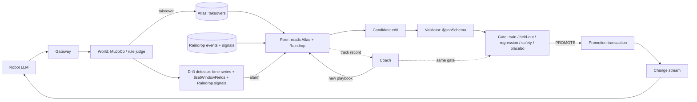

# Intervention Zero

> A robot that needs a human every fifth mission isn't autonomous. Intervention Zero turns every takeover into a tested, permanent fix.

## What it is

Robots that clean, deliver and patrol buildings get stuck: a fire door that needs more force, a cart blocking a corridor, an elevator that is out of service. When that happens a human takes over. Today that takeover is a one-off, and the robot gets stuck the same way tomorrow.

Intervention Zero treats every takeover as a candidate edit to the robot's harness (a rule, a tool policy, or a dispatcher change). A "fixer" agent reads the takeover history and the telemetry and proposes the edit. A gate then tests it on held-out replayed incidents and a safety bank, and promotes it only with 0 safety violations and 0 regressions.

Promotion is a MongoDB transaction, and a change stream hot-reloads every robot with the new version. A "coach" agent does the same for the fixer: it reads the fixer's track record, rewrites the fixer's playbook, and that new playbook goes through the same gate. When a building changes (a drift event), an alarm fires and the fleet heals through the same loop.

## What you get

A Python harness, not a hosted service: a campaign runner that simulates the fleet and runs the improvement loop against MongoDB Atlas, plus a live dashboard that renders the UI event stream (missions, takeovers, gate verdicts, promotions, drift alarms). The robot's tools can also be served as an optional MCP server (`python -m iz.agent.mcp_body`), but MCP is not the product.

## Honest scope

- The world, the buildings and the robots are a **simulator we authored today**. No real robot or real building is involved.
- **MuJoCo** physics judges door and cart situations (force, wait time) and renders 3D clips. Other situations (person down, restricted shortcut, elevator out, low battery, badge door) are judged by plain rules.
- An **LLM decides the robot's actions**, within tools the harness exposes.
- **What is real:** the improvement loop, the gate, the database guardrails (schema validation, transactions, change streams), and the Raindrop telemetry that the fixer reads back.
- Results below are placeholders until real runs fill them. Nothing is invented.

## Architecture



## The loop in 6 steps

1. **Run**: robots execute missions; the world judges each outcome (success, escalated_ok, takeover, escalation_missed, safety_violation).
2. **Record**: each takeover (with the operator's tip) is stored in Atlas; telemetry goes to Raindrop.
3. **Propose**: the fixer retrieves similar past takeovers and proposes a candidate edit with a prediction.
4. **Validate**: the candidate must pass the `$jsonSchema` validator and locked guardrails, or it is refused.
5. **Gate**: replay on train and held-out incidents, the regression set and the safety bank, compared against a placebo edit.
6. **Promote and reload**: on PROMOTE, a transaction writes the new version; the change stream reloads all robots. The coach then reviews the fixer's record.

## Results

All values are filled by real runs. Until then they are placeholders.

| Metric | Value |
|---|---|
| Baseline takeover-free mission rate (held-out) | <!-- RESULT:baseline_tfmr --> |
| Evolved takeover-free mission rate (held-out) | <!-- RESULT:evolved_tfmr --> |
| Placebo takeover-free mission rate (held-out) | <!-- RESULT:placebo_tfmr --> |
| Held-out n | <!-- RESULT:heldout_n --> |
| Seeds | <!-- RESULT:seeds --> |
| Wilson 95% CI (evolved vs baseline) | <!-- RESULT:wilson_ci --> |
| Safety violations after promotion | <!-- RESULT:safety_violations --> |
| Rejected candidates and reasons | <!-- RESULT:rejected_candidates --> |
| Validator refusals | <!-- RESULT:validator_refusals --> |
| Drift detection latency | <!-- RESULT:drift_latency --> |
| Drift recovery | <!-- RESULT:drift_recovery --> |
| Kill -9 resume | <!-- RESULT:kill9_resume --> |
| Coach generations | <!-- RESULT:coach_generations --> |

## Feature to job to file

Every row is marked **verify**. The docs pass checked that each feature appears in the named file (grep). It did not check that the feature runs end to end in the campaign; the final pass confirms that.

| Feature | Job | File | Status |
|---|---|---|---|
| Schema validation (`$jsonSchema`) | Refuse malformed or unsafe candidate edits at the database | `iz/store/schemas.py` | verify |
| Vector search (Voyage embeddings) | Find similar past takeovers | `iz/store/hybrid.py` | verify |
| Atlas Search (text) | Keyword match on tips and situation names | `iz/store/hybrid.py` | verify |
| `$rankFusion` or Python RRF fallback | Fuse vector and text hits | `iz/store/hybrid.py` | verify |
| Voyage rerank | Reorder fused hits | `iz/store/voyage.py` (called from `iz/store/hybrid.py`) | verify |
| Transactions | Atomic promotion of a new harness version | `iz/store/genome_store.py` | verify |
| Change streams | Hot-reload all robots on promotion; feed the UI | `iz/store/genome_store.py`, `iz/store/feed.py` | verify |
| Time series collection | Store per-shift metrics | `iz/store/metrics.py` | verify |
| `$setWindowFields` | Rolling takeover rate for drift detection | `iz/store/metrics.py` | verify |
| `$graphLookup` | Walk the genome version lineage (parent chain) | `iz/store/genome_store.py` | verify |
| `$merge` | Roll up metrics into summary collections | `iz/store/metrics.py` | verify |
| Raindrop events | Log missions, fix cycles, coach cycles (hard cap 900) | `iz/obs/rd.py` | verify |
| Raindrop signals | Self-reports (`agent_report`) and drift signals | `iz/obs/rd.py` | verify |
| Raindrop query read-back | Fixer reads telemetry before proposing | `iz/obs/rd_query.py` | verify |
| Gate, fixer, coach, replay | The improvement loop | `iz/loop/*.py` | verify |
| MCP server (optional) | Exposes the robot's tool surface over stdio | `iz/agent/mcp_body.py` | verify |

## How to run

```powershell
.venv\Scripts\python.exe scripts\setup_atlas.py          # 1. create collections, validators, indexes
.venv\Scripts\python.exe -m iz.loop.campaign             # 2. run_campaign (entry point: verify)
.venv\Scripts\python.exe -m iz.ui                        # 3. ui (entry point: verify)
```

Secrets go in `.env` only. `RAINDROP_ENABLED=0` by default.

## What we did not build

- No real robots, real buildings or real sensors.
- No general physics: only door and cart micro-worlds use MuJoCo.
- No learned policy training; the LLM acts through an editable harness.
- No human approval UI beyond the live dashboard.
- Atlas Agent Engine memory is an optional adapter, not a dependency.

## AI-assisted coding disclosure

Built with Claude Code: Opus orchestrators plus Sonnet coders, human-directed.

## License

MIT. See `LICENSE`.
